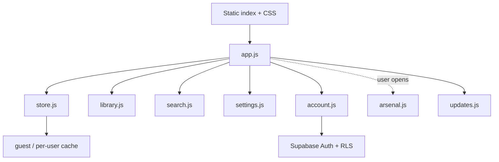

# KageNexus 2.0 Core Rebuild

## Safety boundary

- Baseline: Release 62, commit `be161ba2b131b9d0e7c17a96b56ab085f60511e8` on `main`.
- Rebuild branch: `agent/kagenexus-2-core-rebuild`.
- Publication uses the repository's `main` branch and GitHub Pages.

## Release 62 architecture captured

The old startup downloaded three Base64 parts, rebuilt a ZIP, decompressed five files, rewrote source text, and executed three files with `eval`.

| Package file | Uncompressed bytes |
|---|---:|
| `index.html` | 7,560 |
| `styles.css` | 21,033 |
| `data.js` | 67,548 |
| `config.js` | 164 |
| `app-v2.js` | 31,330 |

The ZIP SHA-256 is `02bd73b54887848edbc1d7a6ad82feaa2915191a35cc83490a0527b83bbce57f`.

The mobile layer separately joined nine Base64 parts into a JSON payload containing 27,679 JavaScript characters and 12,842 CSS characters. It then applied seven exact-source patches before calling `eval`. Its decoded SHA-256 is `f737553a2cd9ff2b2870f60042f1d1341581f5e6408f59b3506261136b4435b1`.

The baseline was verified during the rebuild. Its decoded packages and personal library seed are intentionally absent from this public branch.

## New runtime

- No active `eval` or `new Function`.
- No runtime ZIP, Base64 package joining, or exact-line patching.
- Static CSS files replace core runtime-injected styles.
- A fresh visitor receives an empty Guest library; no personal library is bundled.
- Arsenal data is loaded only after the user opens Arsenal.
- The account SDK loads when Account is opened, a saved session is restored, or an email confirmation/recovery callback is present. A fresh Guest Home does not download it.
- Arsenal still contains 1,778 entries: 1,766 weapons and 12 powers.
- Arsenal still renders 96 cards initially and adds more incrementally.
- The service worker uses a new beta cache and update lifecycle.

## Accounts and import compatibility

- New guest data uses `kagenexus-guest-state-v3`; each account receives a separate `kagenexus-user-state-v3:<user-id>` cache.
- The old `anime-haven-state-v2` key is read only after the user chooses **Move old device data**.
- State schema is version `3`, including deletion tombstones so a stale device cannot revive a removed title.
- Supabase stores one RLS-protected state row per authenticated user; optimistic revisions resolve concurrent updates.
- Unknown future fields from legacy saves remain preserved.
- Raw legacy backup JSON, KageNexus backup envelopes, files, and `KNX1.` sync codes remain accepted.
- Imports retain the newest `updatedAt` value title by title and keep a pre-import safety copy.
- Existing preferences remain under their original keys, including performance mode, search style, Arsenal favorites, and Arsenal recents.

## Automated coverage

`npm run check` verifies:

- clean Guest startup and isolated account caches
- Archive and Unstarted routing/filtering
- Settings, performance choices, and Data & Sync controls
- saved and AniList search behavior
- Up Next ordering and three-card limit
- episode progress and persisted state schema
- backup merge, import safety copy, and Unicode sync-code round trips
- legacy state import and per-title deletion conflict handling
- all 1,778 Arsenal entries, type totals, unique IDs, and 96-card initial rendering
- full feature-module installation
- no active eval, encoded package fetches, runtime source patching, or core style injection

`npm run visual:smoke` launches a real Chromium build and verifies:

- settled desktop renders for Home, Archive, Unstarted, Settings, and Arsenal
- separate mobile Home, account, and Arsenal renders at 390 × 844
- no console errors, uncaught page errors, or failed same-origin requests
- no mobile horizontal overflow
- no eager Arsenal cards during Home startup and exactly 96 cards on Arsenal's first page
- a 450 KB decoded-resource budget and 225 KB JavaScript budget for clean Home startup
- an offline reload through `sw-core.js`

## Release acceptance

The automated suite, desktop/mobile Chromium checks, deployed RLS ownership tests, and production Auth URLs have been verified. Complete the following device/provider checks as those resources become available:

1. Connect a verified SMTP sender, then confirm email sign-up and password recovery delivery.
2. Verify iPhone Safari/PWA behavior on a physical phone.
3. Import the owner's actual old-device library through the account import or same-device migration.
